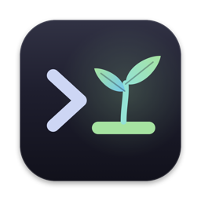
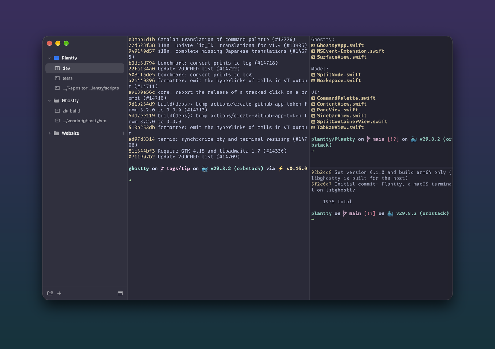
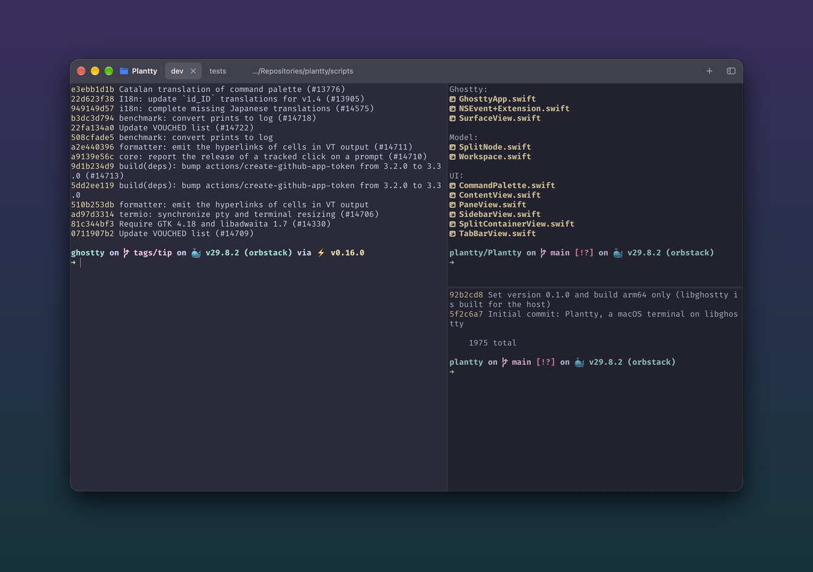
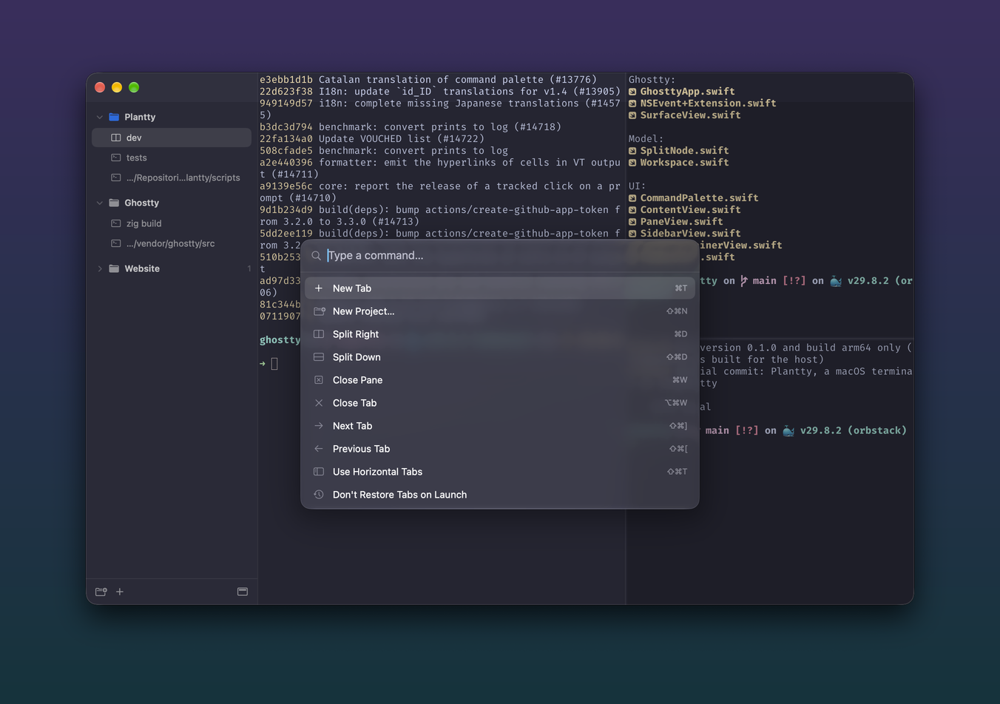

<p align="center">
  
</p>

<h1 align="center">Plantty</h1>

<p align="center">A fast, native macOS terminal built on <a href="https://github.com/ghostty-org/ghostty">libghostty</a>,<br>with projects, vertical or horizontal tabs, and split panes.</p>

<p align="center">
  <a href="https://github.com/florianmari/Plantty/releases/latest"><b>Download for macOS</b></a>
</p>



## Features

- **Ghostty engine** – the terminal emulation, Metal rendering and font handling all come from libghostty, the engine behind Ghostty.
- **Uses your Ghostty config** – Plantty reads `~/.config/ghostty/config`, so your theme, font, keybinds, transparency and blur carry over.
- **Projects** – group tabs under a folder. New tabs open in the project's folder.
- **Vertical or horizontal tabs** – a sidebar of projects with their tabs nested underneath, or a compact tab bar with a project dropdown. Switch with <kbd>⇧⌘T</kbd>.
- **Split panes** – split right or down, nested as deep as you like. Drag a divider to resize; unfocused panes are dimmed.
- **Command palette** – <kbd>⇧⌘P</kbd> runs any action and jumps to any project or tab.
- **Rename tabs and projects** – right-click them or use the palette.
- **Session restore** – reopens your tabs and splits, each pane in the folder it was last in. You can turn this off in the Tabs menu.
- **Paste files and screenshots** – <kbd>⌘V</kbd> with a copied file pastes its path. With a copied image, such as a screenshot taken with <kbd>⌃⇧⌘4</kbd>, it saves the image to a temporary PNG and pastes that path, which suits CLI tools like Claude Code.

<table>
  <tr>
    <td></td>
    <td></td>
  </tr>
  <tr>
    <td align="center">Horizontal tabs with a project dropdown</td>
    <td align="center">Command palette (<kbd>⇧⌘P</kbd>)</td>
  </tr>
</table>

## Keyboard shortcuts

| Action | Shortcut |
| --- | --- |
| New tab | <kbd>⌘T</kbd> |
| New project | <kbd>⇧⌘N</kbd> |
| Split right / down | <kbd>⌘D</kbd> / <kbd>⇧⌘D</kbd> |
| Close pane / tab | <kbd>⌘W</kbd> / <kbd>⌥⌘W</kbd> |
| Next / previous tab | <kbd>⇧⌘]</kbd> / <kbd>⇧⌘[</kbd> |
| Go to tab 1–9 | <kbd>⌘1</kbd> … <kbd>⌘9</kbd> |
| Next / previous split | <kbd>⌘]</kbd> / <kbd>⌘[</kbd> |
| Next / previous project | <kbd>⌃⌘]</kbd> / <kbd>⌃⌘[</kbd> |
| Command palette | <kbd>⇧⌘P</kbd> |
| Vertical ↔ horizontal tabs | <kbd>⇧⌘T</kbd> |

When a terminal has focus, the keybinds in your Ghostty config take priority.

## Install

Download `Plantty.dmg` from the [latest release](https://github.com/florianmari/Plantty/releases/latest), open it, and drag Plantty onto Applications. A `Plantty.zip` is also available.

The build is not notarized, which means Apple has not checked it. macOS will block it the first time you open it. Either right-click the app and choose **Open**, or run:

```sh
xattr -dr com.apple.quarantine /Applications/Plantty.app
```

You need macOS 26 or later on Apple Silicon.

## Build from source

You need:

- Xcode 26 or later
- [Zig](https://ziglang.org) 0.16
- [XcodeGen](https://github.com/yonaskolb/XcodeGen)

Install the last two with `brew install zig xcodegen`. Then:

```sh
./scripts/build-ghostty.sh   # builds GhosttyKit.xcframework and resources into vendor/ (once, several minutes)
xcodegen generate            # creates Plantty.xcodeproj from project.yml
xcodebuild -project Plantty.xcodeproj -scheme Plantty -configuration Release -derivedDataPath build build
open build/Build/Products/Release/Plantty.app
```

Run the tests with:

```sh
xcodebuild -project Plantty.xcodeproj -scheme Plantty -derivedDataPath build test
```

Ghostty is pinned to one commit in `scripts/build-ghostty.sh`, because its embedding API changes often. To update it, change `GHOSTTY_COMMIT`, delete `vendor/GhosttyKit.xcframework` and run the script again.

## Project layout

```
Plantty/
  Ghostty/     libghostty bridge: app runtime and callbacks, the terminal NSView, key input
  Model/       Workspace (projects, tabs, panes, saving) and SplitNode (split layout tree)
  UI/          SwiftUI: sidebar, tab bar, split container, command palette
PlanttyTests/  unit tests for the split layout and its saved form
scripts/       build-ghostty.sh, make-icon.swift (draws the app icon)
project.yml    XcodeGen project definition
```

Projects and saved tabs are stored in `~/Library/Application Support/Plantty/projects.json`.

## License

Plantty is released under the [MIT License](LICENSE), the same license as Ghostty.

It embeds [Ghostty](https://github.com/ghostty-org/ghostty) by Mitchell Hashimoto and the Ghostty contributors (MIT). Parts of the input handling are adapted from Ghostty's macOS app, and those files keep the original notice. libghostty and the libraries compiled into it are listed in [THIRD_PARTY_NOTICES.md](THIRD_PARTY_NOTICES.md), which also ships inside the app.
